# The admin panel

Every page of `/admin`, signed in with the `USER` and `PASSWORD` the run was
started with, over a made up world: 312 accounts, six organizations, two
months of AI use by model, a month of site visits and the security log.
Taken by `scripts/screenshots/run.mjs`; the full pages are linked.

  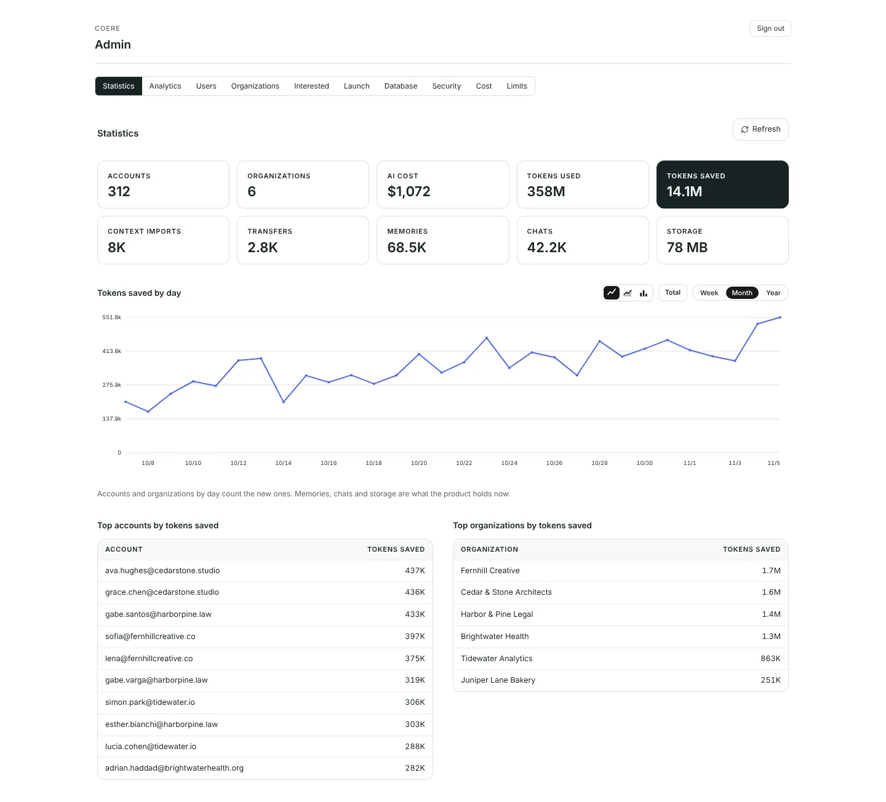
   
  Statistics: the running totals, by day, and the top accounts and organizations.

| | |
|---|---|
| 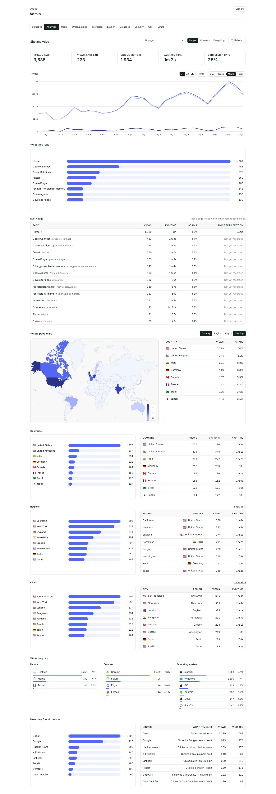 Analytics: the site's visits, pages and sources | 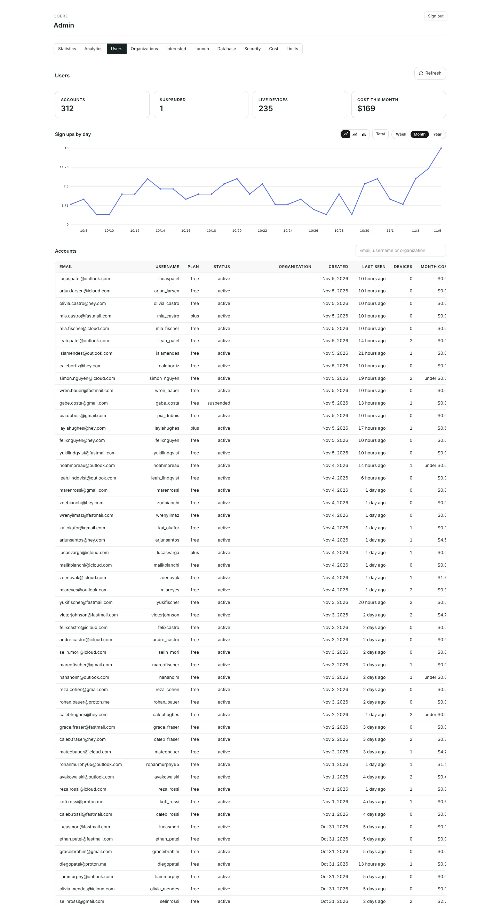 Users: every account (the first screens of the list) |
| 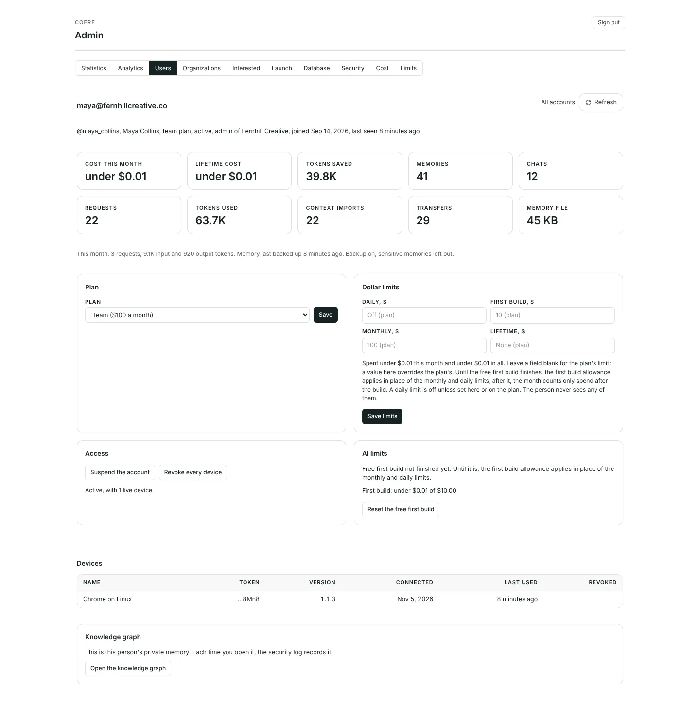 One account | 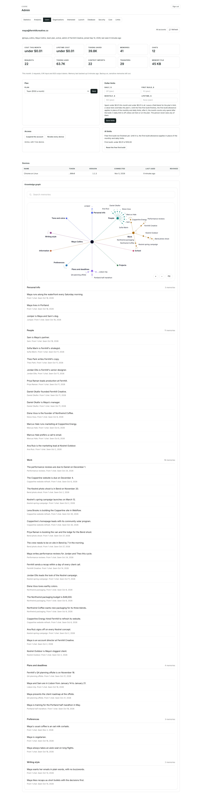 Its knowledge graph, opened by a click and logged |
| 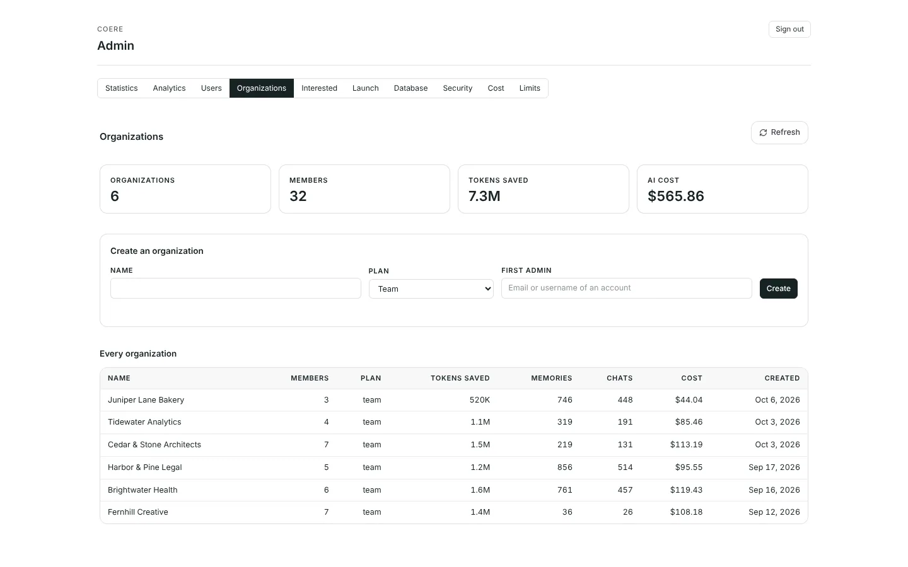 Organizations, and the only place one is made | 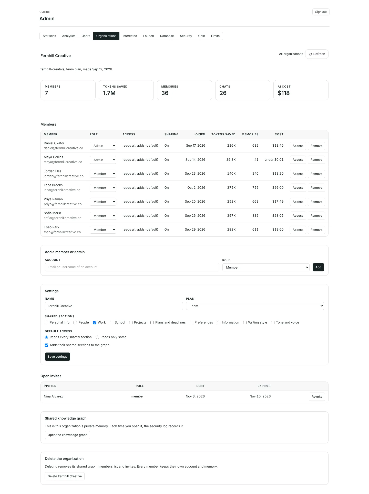 One organization |
| 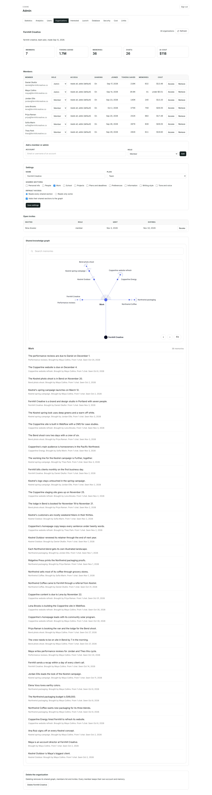 Its shared graph, with who brought each memory | 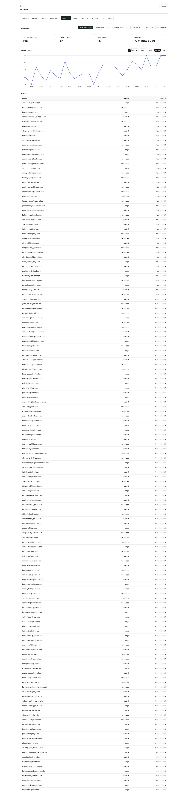 Interested: the waitlist and both interest lists |
| 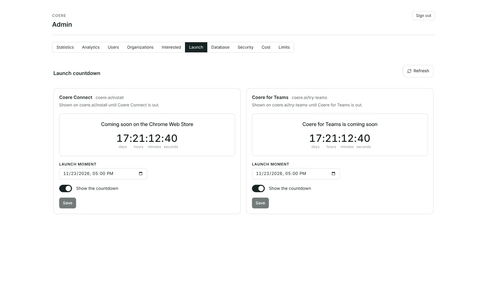 Launch: the countdowns on /install and /try-teams | 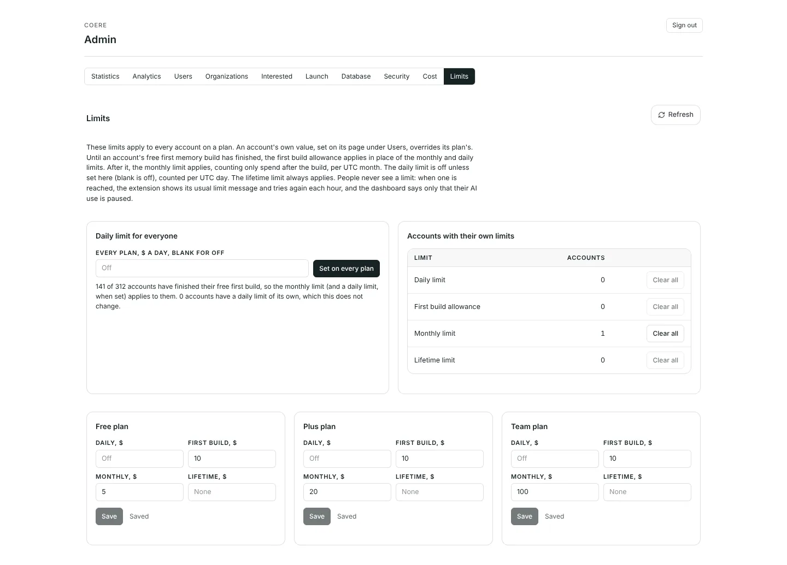 Limits |
| 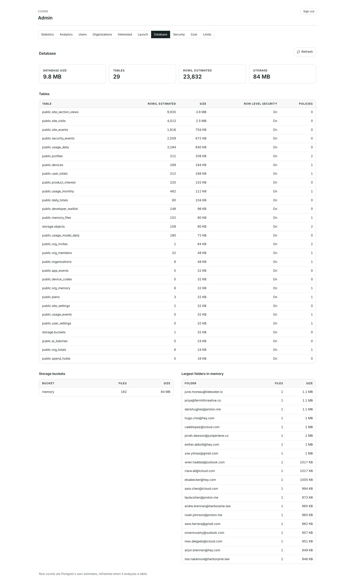 Database | 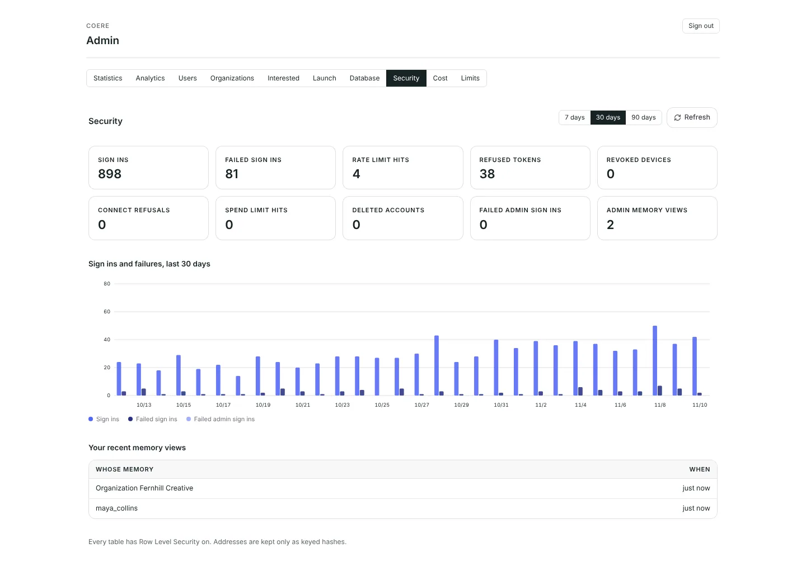 Security |
| 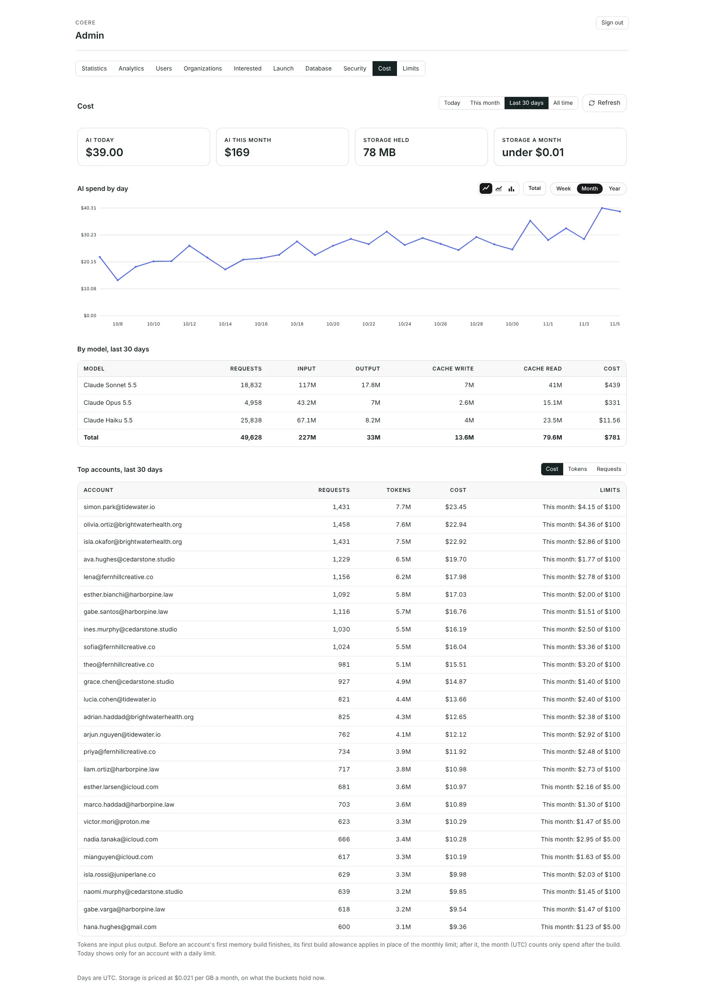 Cost | 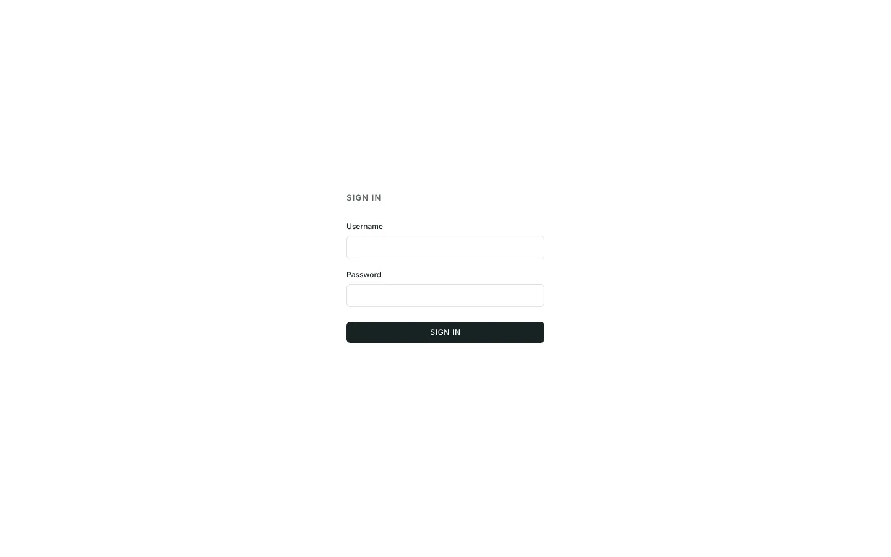 The panel's own sign in |
