# The dashboard

`coere.ai/dashboard` frames the extension's own Console full screen, so
these are the Console itself, the same app and style as in the extension's
own tab, inside the site's host page. The extension is coere-v2's fake v4
build, signed in to the local site as Maya Collins through `/connect`. Her
34 chats are in the Library, and her memory is a file written by the
extension's own memory code from those chats and imported on the Memory
page, as a person imports one; her browser then backs it up to the site,
which merges Fernhill Creative's shared graph. Maya, her agency and her
clients are made up for these pictures. Taken by
`scripts/screenshots/run.mjs`.

  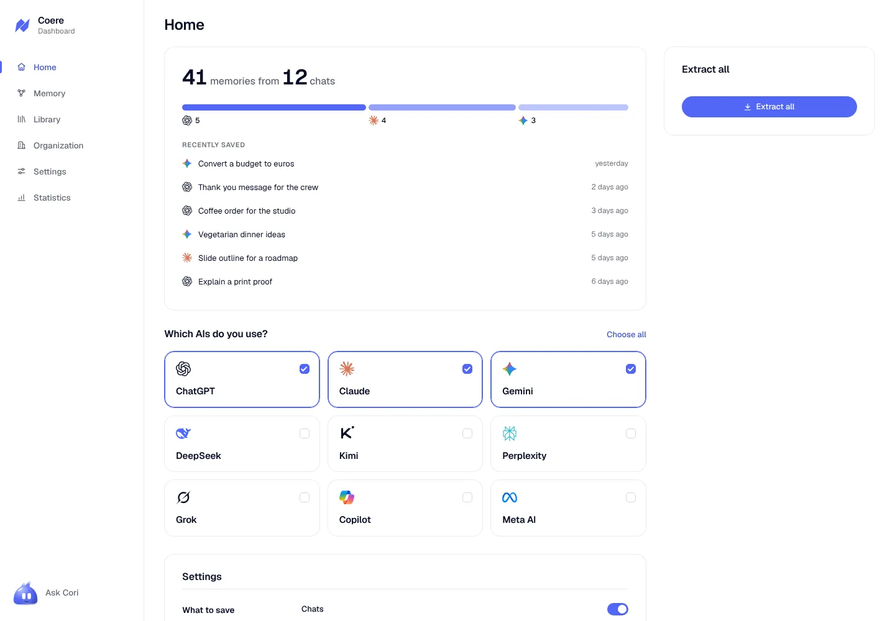
   
  Home: what memory holds, the chats saved last, and the AIs she uses.

| | |
|---|---|
| 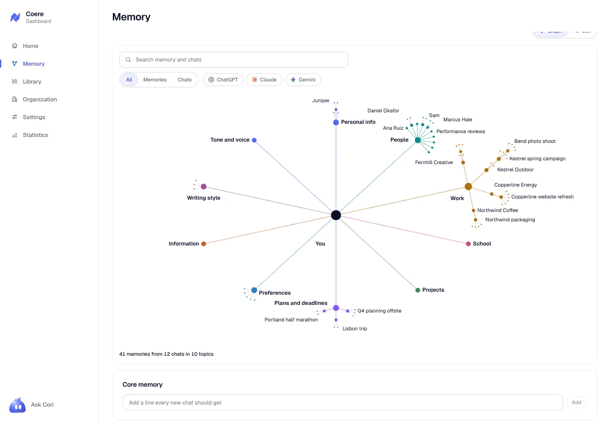 Memory: one graph around her, section by section | 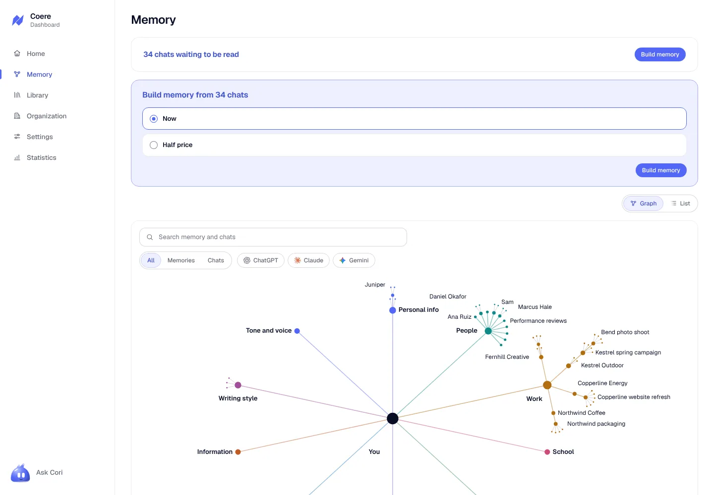 Memory's top. Her memory came in a file, so the chats wait for a build of their own |
| 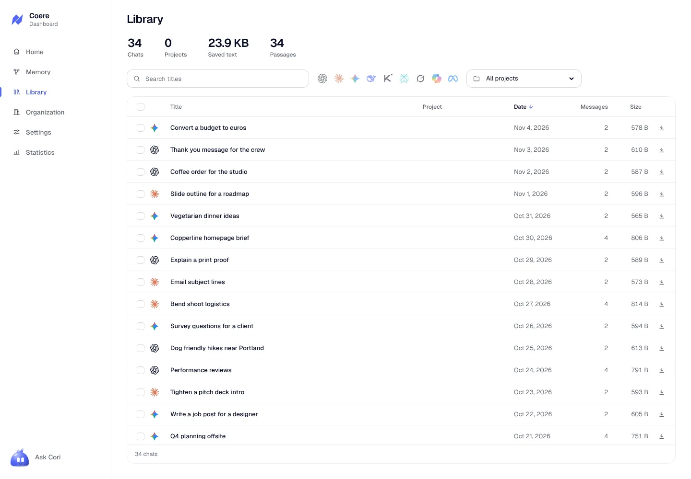 The Library: every saved chat | 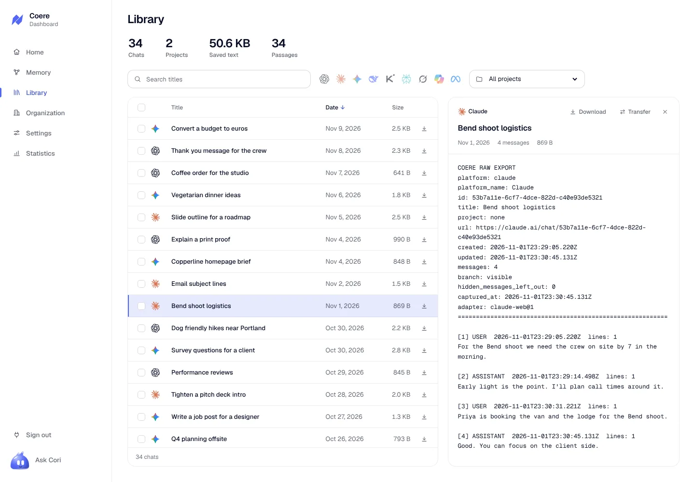 A chat open in the Library |
| 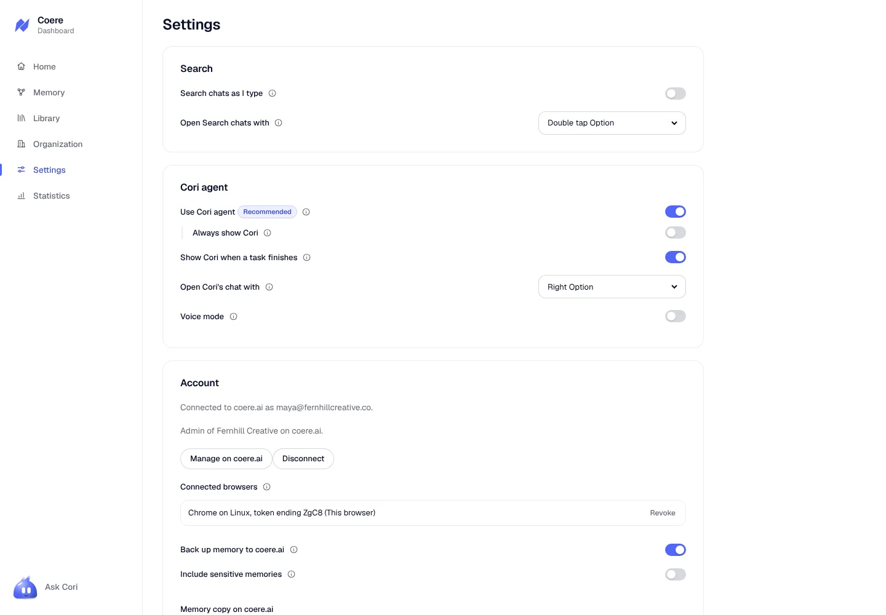 Settings | 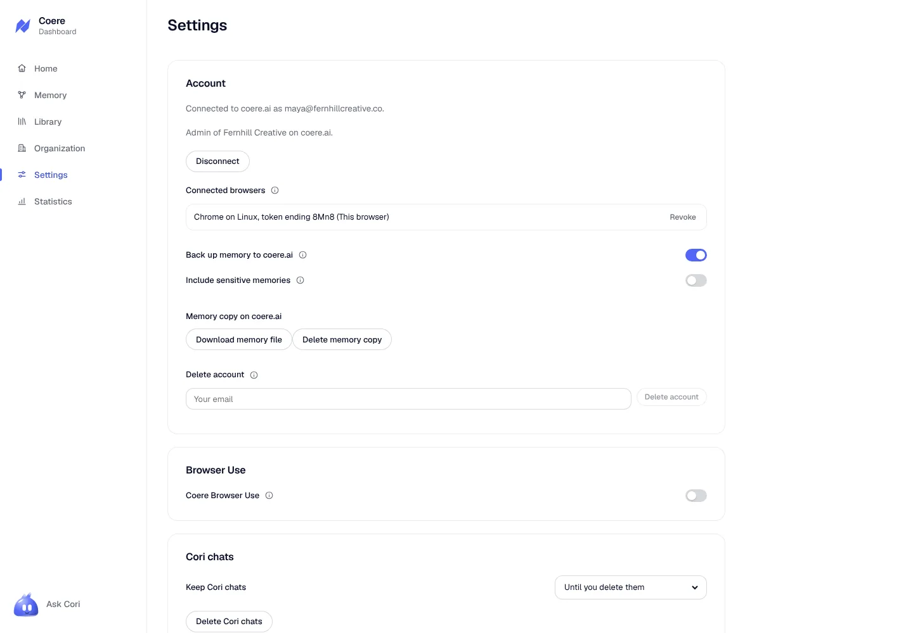 The Account card: the account on coere.ai, browsers, backup and the memory copy |
|  Organization, as an admin, with the shared graph | 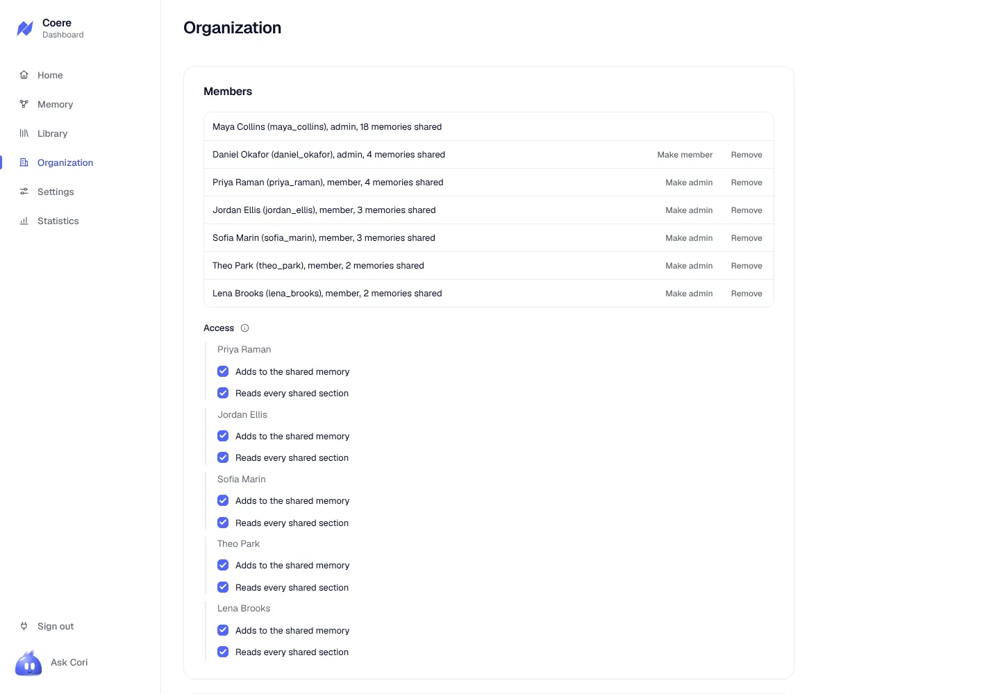 An admin's members list and invites |
| 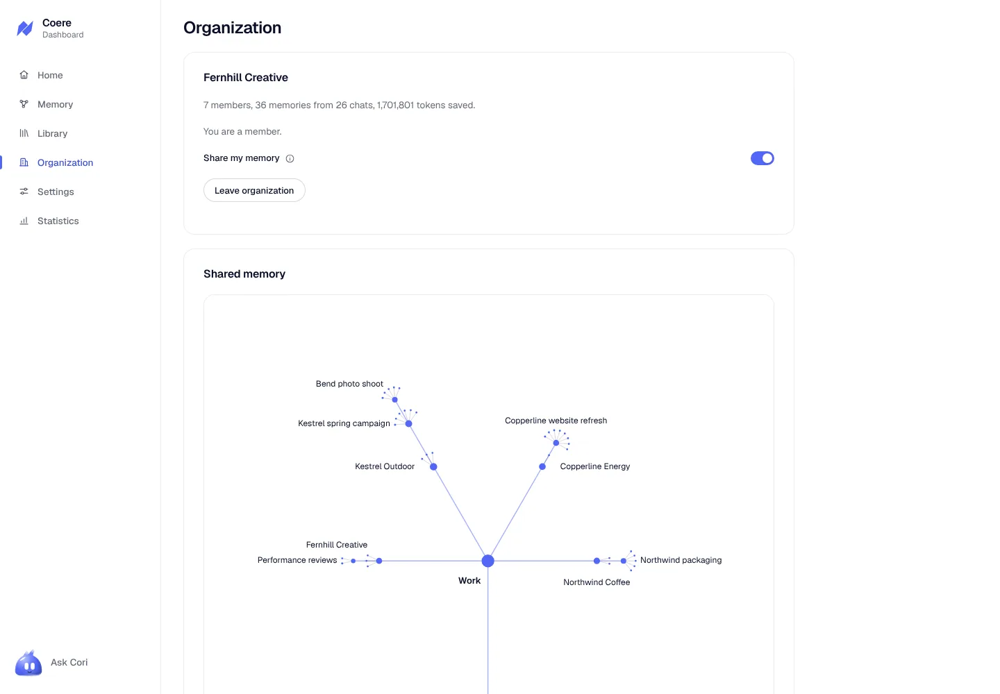 Organization, as a member | 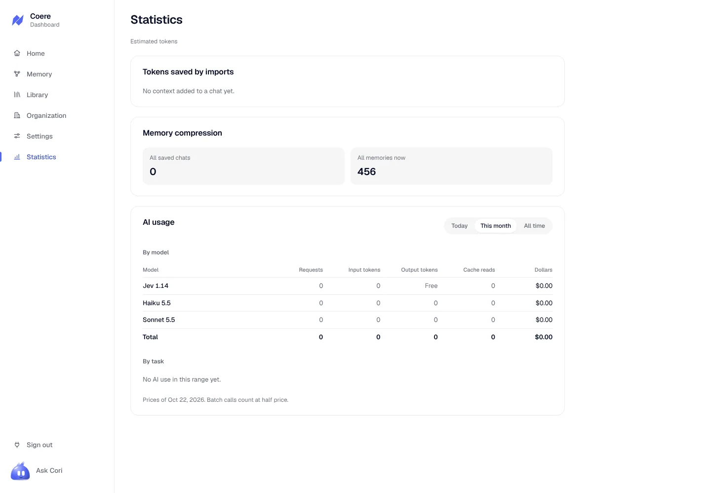 Statistics. Maya's memory came in a file, so this browser has read none of its chats and sent no context yet: its saved chats, imports and use are zero |
| 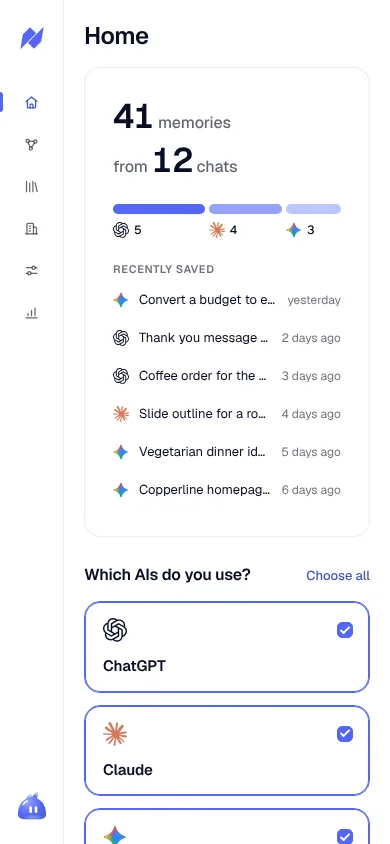 Home at 390 wide | 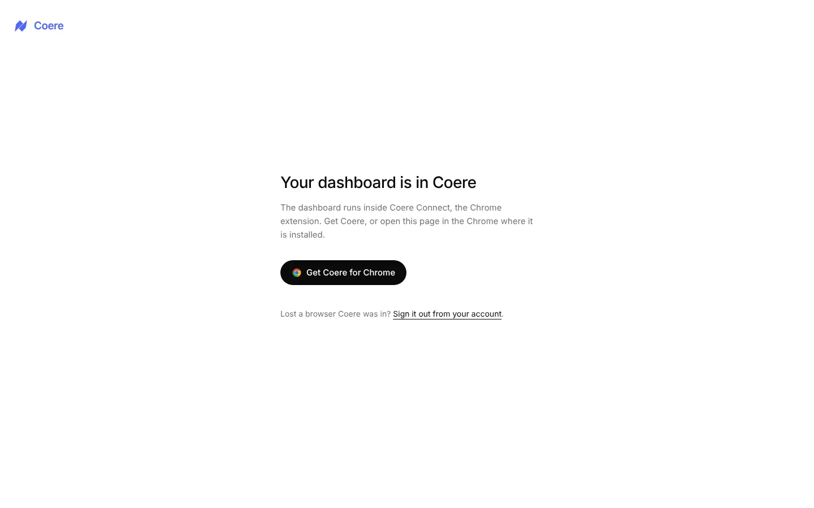 What /dashboard shows when no extension answers |

For Organization as a member, the tool sets Maya's role to member in the
local database, as an admin's Make member would, and back after.
